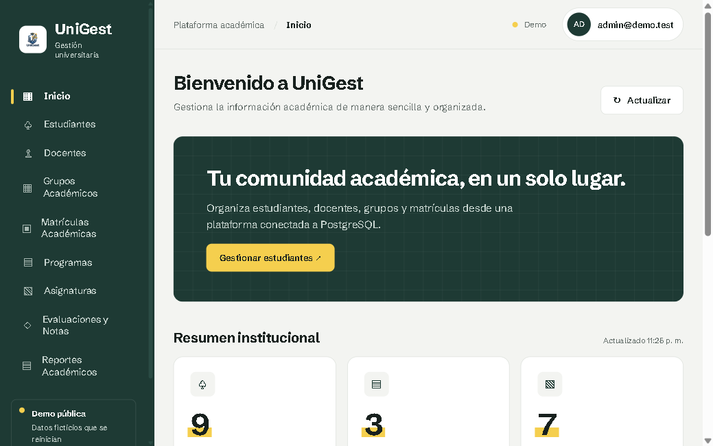
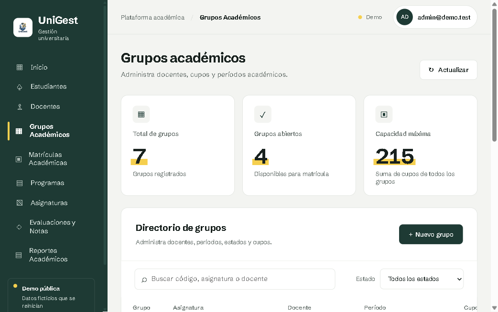
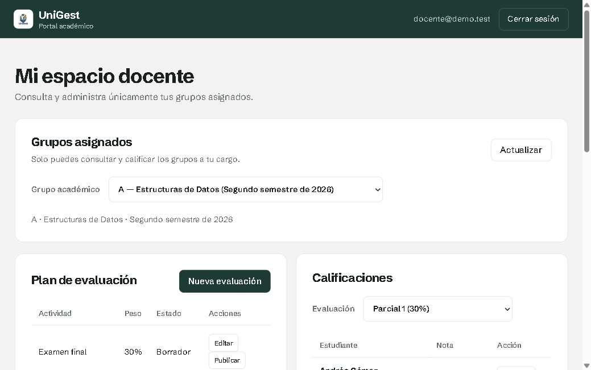
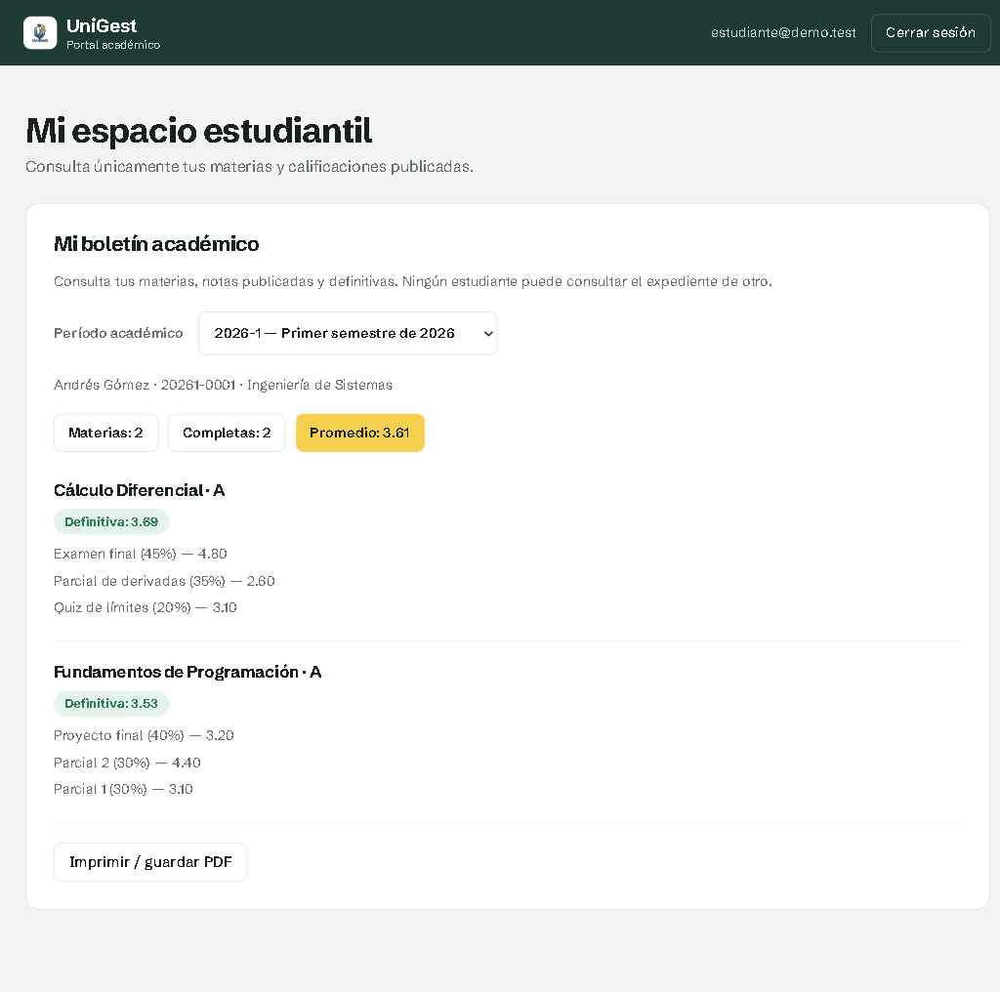

# 🎓 UniGest — Sistema de Gestión Académica Universitaria


[](https://unigest-d9zx.onrender.com)
[](https://github.com/stiven-triana-dev/UniGest/actions)

**UniGest** es una aplicación web para administrar procesos académicos universitarios con tres espacios de trabajo: **administración, docencia y estudiantes**. Gestiona matrículas, grupos, evaluaciones, calificaciones y boletines, con acceso controlado según el rol del usuario.

**Versión:** `v0.11.0` · **Pruebas:** 97 automatizadas, 0 fallos · **CI:** GitHub Actions con Java 21 y PostgreSQL 18

## 🌐 Demo en línea

**[unigest-d9zx.onrender.com](https://unigest-d9zx.onrender.com)**: en la pantalla de inicio de sesión elige una cuenta y entras con un clic.

| Rol | Correo | Qué puedes probar |
| --- | --- | --- |
| Administración | `admin@demo.test` | Estudiantes, docentes, grupos, matrículas, evaluaciones, notas y reportes |
| Docente | `docente@demo.test` | Sus grupos, el plan de evaluación y el libro de notas |
| Estudiante | `estudiante@demo.test` | Su boletín por periodo, con notas publicadas y definitivas |

Contraseña de las tres cuentas: `Demo-UniGest-2026`. Los datos son ficticios y se reinician cada vez que el servicio arranca, y las cuentas de prueba no se pueden modificar. La primera visita puede tardar cerca de un minuto mientras el servidor gratuito despierta.

## 🖼️ Capturas

| Panel administrativo | Grupos académicos |
| --- | --- |
|  |  |

| Portal docente | Boletín del estudiante |
| --- | --- |
|  |  |

## ✨ Funcionalidades

| Rol | Qué puede hacer |
| --- | --- |
| **Administrador** | Gestionar estudiantes, docentes, programas, asignaturas, periodos, grupos y matrículas; consultar evaluaciones, calificaciones y reportes; emitir credenciales temporales. |
| **Docente** | Consultar sus grupos asignados; crear y publicar evaluaciones; registrar calificaciones y ver resultados. |
| **Estudiante** | Consultar sus periodos, asignaturas, notas publicadas y boletines; imprimir o guardar el boletín como PDF. |

Además incluye cálculo de notas definitivas, historial de correcciones de calificaciones, desactivación lógica de cuentas y exportación de reportes a CSV.

## 🛠️ Tecnologías

| Capa | Tecnologías |
| --- | --- |
| Backend | Java 21, Spring Boot 4.1.1, Spring MVC, Spring Data JPA |
| Seguridad | Spring Security, sesiones HTTP, CSRF, BCrypt, control de acceso por roles |
| Base de datos | PostgreSQL 18, migraciones con Flyway |
| Frontend | HTML, CSS y JavaScript nativo (sin frameworks) |
| Pruebas | JUnit 5, Mockito, Spring Boot Test, Spring Security Test |
| CI | GitHub Actions |

## 🧱 Arquitectura

El código está organizado **por módulo de negocio** (estudiante, docente, grupo, matrícula, calificación, evaluación, reporte, usuario, portal...). Cada módulo sigue la misma estructura:

`Controller` (API REST) → `Service` (lógica y reglas de negocio) → `Repository` (JPA) → `Entity`, con `Request` / `Response` como objetos de transferencia.

```text
UniGest/
├── .github/workflows/tests.yml      # Integración continua
├── docs/                            # Documentación técnica
├── scripts/                         # Scripts de inicio y pruebas (PowerShell)
├── src/
│   ├── main/
│   │   ├── java/com/unigest/        # API, lógica de negocio y seguridad
│   │   └── resources/
│   │       ├── db/migration/        # Migraciones Flyway V1–V5
│   │       ├── static/panel/        # Panel administrativo
│   │       ├── static/portal/       # Portales docente y estudiante
│   │       └── application.yml
│   └── test/java/com/unigest/       # Pruebas automatizadas
└── pom.xml
```

## 🚀 Cómo ejecutarlo

### Requisitos

- Java 21 (JDK)
- PostgreSQL 18
- Maven 3.9+ (o el que tengas instalado como `mvn`)

### 1. Clonar el proyecto

```bash
git clone https://github.com/stiven-triana-dev/UniGest.git
cd UniGest
```

### 2. Crear la base de datos

```sql
CREATE DATABASE unigest;
```

Flyway crea las tablas y un catálogo de **datos ficticios** automáticamente al iniciar.

### 3. Configurar la conexión (variables de entorno)

La contraseña nunca va en el código: se lee de variables de entorno.

**Linux / macOS**

```bash
export DB_URL="jdbc:postgresql://localhost:5432/unigest"
export DB_USER="postgres"
export DB_PASSWORD="tu_contraseña"
```

**Windows (PowerShell)**

```powershell
$env:DB_URL = "jdbc:postgresql://localhost:5432/unigest"
$env:DB_USER = "postgres"
$env:DB_PASSWORD = "tu_contraseña"
```

### 4. Crear el administrador inicial (solo en una base nueva)

```bash
export UNIGEST_ADMIN_EMAIL="admin@example.test"
export UNIGEST_ADMIN_PASSWORD="una-clave-de-minimo-12-caracteres"
```

Solo se crea si aún no existe y nunca reemplaza la contraseña de un administrador existente.

### 5. Iniciar

```bash
mvn spring-boot:run
```

Luego abre:

- **Panel administrativo:** http://localhost:8080/panel/index.html
- **Portal docente y estudiante:** http://localhost:8080/portal/index.html

### Modo demo y Docker

- `UNIGEST_DEMO=true` carga datos ficticios al arrancar (`src/main/resources/demo/datos-demo.sql`) y crea las tres cuentas de prueba de la demo. **Vacía las tablas académicas**: úsalo solo en una base dedicada a la demo.
- El `Dockerfile` compila con Maven y ejecuta con Java 21 limitando la memoria para el plan gratuito de Render (512 MB). Variables: `DB_URL` (formato `jdbc:postgresql://HOST/BASE?sslmode=require`), `DB_USER`, `DB_PASSWORD` y, para la demo, `UNIGEST_DEMO=true`.

> En Windows también puedes usar los scripts de `scripts/` (`Iniciar-UniGest.ps1` y `Probar-UniGest.ps1`), que piden la contraseña de forma segura.

## 🧪 Pruebas

```bash
mvn clean test
```

Resultado verificado:

```text
Tests run: 97, Failures: 0, Errors: 0, Skipped: 0
BUILD SUCCESS
```

Las pruebas cubren lógica de negocio (cálculo de notas, matrículas, cupos), servicios, **autorización por rol** (por ejemplo, un estudiante recibe `403` en rutas administrativas) y pruebas de integración con PostgreSQL. GitHub Actions las ejecuta en cada `push` y `pull request`.

## 🔐 Seguridad

- Autenticación con Spring Security y sesiones HTTP.
- Autorización por roles `ADMIN`, `DOCENTE` y `ESTUDIANTE`, con restricciones adicionales en los servicios (un docente solo ve sus grupos, un estudiante solo sus notas publicadas).
- Contraseñas con **BCrypt**; las credenciales temporales deben cambiarse antes de consultar datos académicos.
- Protección **CSRF** activada.
- Cookies `HttpOnly` y `SameSite=Lax`; la sesión expira a los 30 minutos de inactividad.
- Por defecto escucha solo en `127.0.0.1`.
- Los errores no exponen mensajes internos ni trazas.

> **Nota:** esta versión está pensada para uso local y demostración. Para exponerla a internet haría falta HTTPS, `SESSION_COOKIE_SECURE=true`, gestión de secretos y un usuario de base de datos con privilegios mínimos.

## 🗺️ Próximas mejoras

- [ ] Documentación de la API con OpenAPI/Swagger
- [ ] `docker-compose` para levantar la aplicación y PostgreSQL con un solo comando
- [ ] Paginación y filtros en los listados
- [x] Despliegue en línea con HTTPS (Render + Neon, con Docker)

## 👤 Autor

**Stiven** — Estudiante de Ingeniería de Sistemas · San Gil, Colombia  
[GitHub](https://github.com/stiven-triana-dev) · [VisagShop](https://github.com/stiven-triana-dev/VisagShop)
