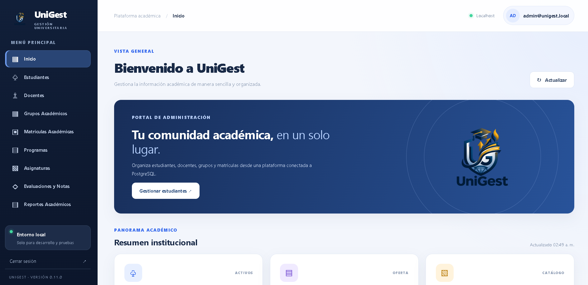
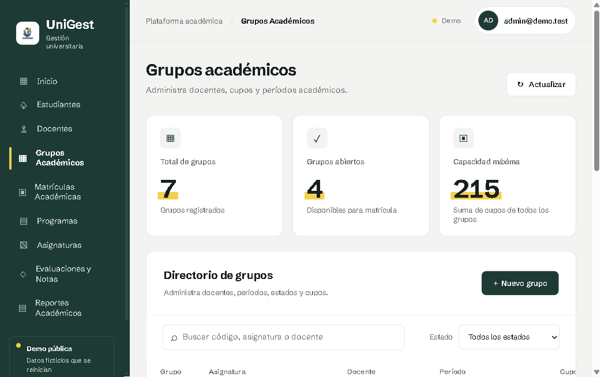
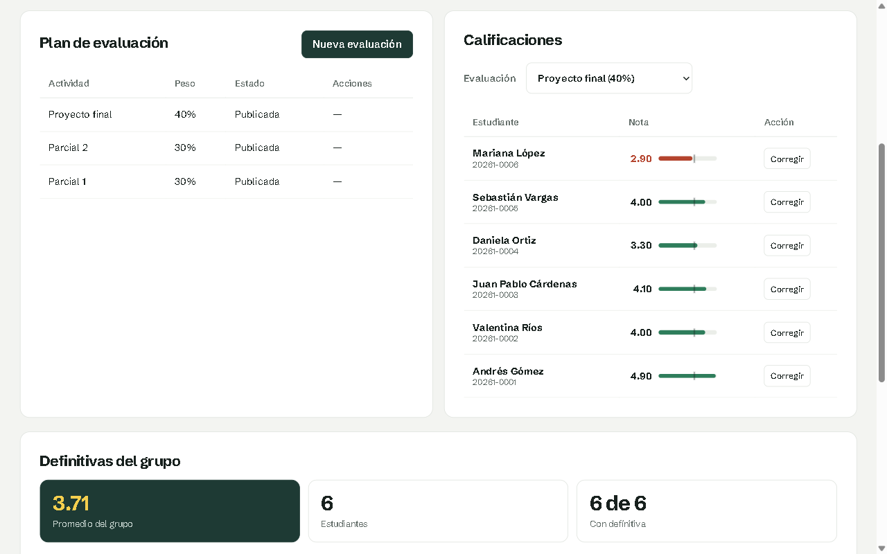
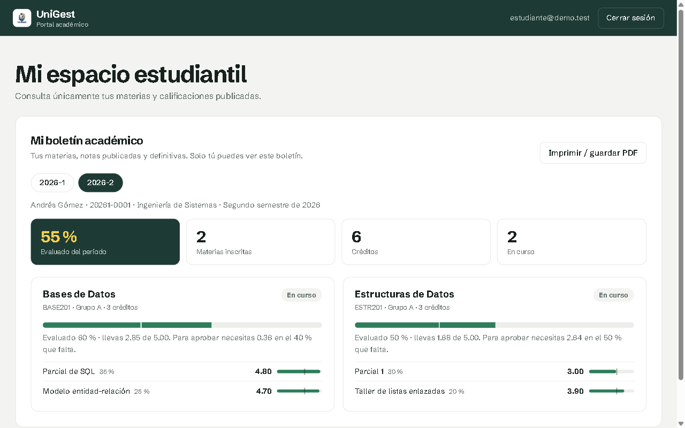
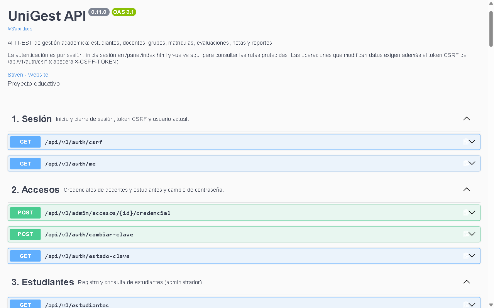

# 🎓 UniGest — Sistema de Gestión Académica Universitaria


[](https://unigest-d9zx.onrender.com)
[](https://unigest-d9zx.onrender.com/swagger-ui.html)
[](https://github.com/stiven-triana-dev/UniGest/actions)

**UniGest** es una aplicación web para administrar procesos académicos universitarios con tres espacios de trabajo: **administración, docencia y estudiantes**. Gestiona matrículas, grupos, evaluaciones, calificaciones y boletines, con acceso controlado según el rol del usuario.

**Versión:** `v0.11.0` · **Pruebas:** 101 automatizadas, 0 fallos · **CI:** GitHub Actions con Java 21 y PostgreSQL 18

## 🌐 Demo en línea

**[unigest-d9zx.onrender.com](https://unigest-d9zx.onrender.com)**: en la pantalla de inicio de sesión elige una cuenta y entras con un clic.

| Rol | Correo | Qué puedes probar |
| --- | --- | --- |
| Administración | `admin@demo.test` | Estudiantes, docentes, grupos, matrículas, evaluaciones, notas y reportes |
| Docente | `docente@demo.test` | Sus grupos, el plan de evaluación y el libro de notas |
| Estudiante | `estudiante@demo.test` | Su boletín por periodo, con notas publicadas y definitivas |

**Documentación de la API:** [unigest-d9zx.onrender.com/swagger-ui.html](https://unigest-d9zx.onrender.com/swagger-ui.html), con todas las rutas REST agrupadas por módulo. Para consultar las rutas protegidas, primero inicia sesión en la demo.

Contraseña de las tres cuentas: `Demo-UniGest-2026`. Los datos son ficticios y se reinician cada vez que el servicio arranca, y las cuentas de prueba no se pueden modificar. La primera visita puede tardar cerca de un minuto mientras el servidor gratuito despierta.

## 🖼️ Capturas

| Panel administrativo | Grupos académicos |
| --- | --- |
|  |  |

| Portal docente | Boletín del estudiante |
| --- | --- |
|  |  |

| Documentación de la API (Swagger) |
| --- |
|  |

## ✨ Funcionalidades

| Rol | Qué puede hacer |
| --- | --- |
| **Administrador** | Gestionar estudiantes, docentes, programas, asignaturas, periodos, grupos y matrículas; consultar evaluaciones, calificaciones y reportes; emitir credenciales temporales. |
| **Docente** | Consultar sus grupos asignados; crear y publicar evaluaciones; registrar calificaciones y ver resultados. |
| **Estudiante** | Consultar sus periodos, asignaturas, notas publicadas y boletines; imprimir o guardar el boletín como PDF. |

Además incluye cálculo de notas definitivas (y, en materias en curso, la nota que le falta al estudiante para aprobar), historial de correcciones de calificaciones, desactivación lógica de cuentas y exportación de reportes a CSV.

## 🛠️ Tecnologías

| Capa | Tecnologías |
| --- | --- |
| Backend | Java 21, Spring Boot 4.1.1, Spring MVC, Spring Data JPA |
| Documentación | OpenAPI 3.1 con springdoc y Swagger UI |
| Seguridad | Spring Security, sesiones HTTP, CSRF, BCrypt, control de acceso por roles |
| Base de datos | PostgreSQL 18, migraciones con Flyway |
| Frontend | HTML, CSS y JavaScript nativo (sin frameworks) |
| Pruebas | JUnit 5, Mockito, Spring Boot Test, Spring Security Test |
| CI | GitHub Actions |

## 🧱 Arquitectura

El código está organizado **por módulo de negocio** (estudiante, docente, grupo, matrícula, calificación, evaluación, reporte, usuario, portal...). Cada módulo sigue la misma estructura:

`Controller` (API REST) → `Service` (lógica y reglas de negocio) → `Repository` (JPA) → `Entity`, con `Request` / `Response` como objetos de transferencia.

```text
UniGest/
├── .github/workflows/tests.yml      # Integración continua
├── docs/                            # Documentación técnica
├── scripts/                         # Scripts de inicio y pruebas (PowerShell)
├── src/
│   ├── main/
│   │   ├── java/com/unigest/        # API, lógica de negocio y seguridad
│   │   └── resources/
│   │       ├── db/migration/        # Migraciones Flyway V1–V5
│   │       ├── static/panel/        # Panel administrativo
│   │       ├── static/portal/       # Portales docente y estudiante
│   │       └── application.yml
│   └── test/java/com/unigest/       # Pruebas automatizadas
└── pom.xml
```

## 🚀 Cómo ejecutarlo

### Requisitos

- Java 21 (JDK)
- PostgreSQL 18
- Maven 3.9+ (o el que tengas instalado como `mvn`)

### 1. Clonar el proyecto

```bash
git clone https://github.com/stiven-triana-dev/UniGest.git
cd UniGest
```

### 2. Crear la base de datos

```sql
CREATE DATABASE unigest;
```

Flyway crea las tablas y un catálogo de **datos ficticios** automáticamente al iniciar.

### 3. Configurar la conexión (variables de entorno)

La contraseña nunca va en el código: se lee de variables de entorno.

**Linux / macOS**

```bash
export DB_URL="jdbc:postgresql://localhost:5432/unigest"
export DB_USER="postgres"
export DB_PASSWORD="tu_contraseña"
```

**Windows (PowerShell)**

```powershell
$env:DB_URL = "jdbc:postgresql://localhost:5432/unigest"
$env:DB_USER = "postgres"
$env:DB_PASSWORD = "tu_contraseña"
```

### 4. Crear el administrador inicial (solo en una base nueva)

```bash
export UNIGEST_ADMIN_EMAIL="admin@example.test"
export UNIGEST_ADMIN_PASSWORD="una-clave-de-minimo-12-caracteres"
```

Solo se crea si aún no existe y nunca reemplaza la contraseña de un administrador existente.

### 5. Iniciar

```bash
mvn spring-boot:run
```

Luego abre:

- **Panel administrativo:** http://localhost:8080/panel/index.html
- **Portal docente y estudiante:** http://localhost:8080/portal/index.html

### Modo demo y Docker

- `UNIGEST_DEMO=true` carga datos ficticios al arrancar (`src/main/resources/demo/datos-demo.sql`) y crea las tres cuentas de prueba de la demo. **Vacía las tablas académicas**: úsalo solo en una base dedicada a la demo.
- El `Dockerfile` compila con Maven y ejecuta con Java 21 limitando la memoria para el plan gratuito de Render (512 MB). Variables: `DB_URL` (formato `jdbc:postgresql://HOST/BASE?sslmode=require`), `DB_USER`, `DB_PASSWORD` y, para la demo, `UNIGEST_DEMO=true`.

> En Windows también puedes usar los scripts de `scripts/` (`Iniciar-UniGest.ps1` y `Probar-UniGest.ps1`), que piden la contraseña de forma segura.

## 🧪 Pruebas

```bash
mvn clean test
```

Resultado verificado:

```text
Tests run: 100, Failures: 0, Errors: 0, Skipped: 0
BUILD SUCCESS
```

Las pruebas cubren lógica de negocio (cálculo de notas, matrículas, cupos), servicios, **autorización por rol** (por ejemplo, un estudiante recibe `403` en rutas administrativas) y pruebas de integración con PostgreSQL. GitHub Actions las ejecuta en cada `push` y `pull request`.

## 🔐 Seguridad

- Autenticación con Spring Security y sesiones HTTP.
- Autorización por roles `ADMIN`, `DOCENTE` y `ESTUDIANTE`, con restricciones adicionales en los servicios (un docente solo ve sus grupos, un estudiante solo sus notas publicadas).
- Contraseñas con **BCrypt**; las credenciales temporales deben cambiarse antes de consultar datos académicos.
- Protección **CSRF** activada.
- Cookies `HttpOnly` y `SameSite=Lax`; la sesión expira a los 30 minutos de inactividad.
- Por defecto escucha solo en `127.0.0.1`.
- Los errores no exponen mensajes internos ni trazas.
- La documentación de la API (`/swagger-ui.html`) es pública, pero no abre los datos: cada ruta sigue exigiendo sesión y rol. Se desactiva con `API_DOCS=false`.

> **Nota:** esta versión está pensada para uso local y demostración. Para exponerla a internet haría falta HTTPS, `SESSION_COOKIE_SECURE=true`, gestión de secretos y un usuario de base de datos con privilegios mínimos.

## Lo que aprendí con este proyecto

UniGest fue mi primer proyecto serio con Java y Spring Boot. Lo armé por capas (controlador, servicio, repositorio) y con eso entendí para qué sirve cada una: el controlador solo recibe y responde, la regla de negocio vive en el servicio y el repositorio habla con PostgreSQL. Las reglas que más trabajo me dieron fueron las de las notas: un promedio solo es definitivo si todas las evaluaciones están completas, y nadie puede matricularse en un grupo lleno.

Flyway me enseñó a tratar la base de datos como código: cada cambio es una migración numerada (de V1 a V5) y, una vez aplicada, no se vuelve a editar, porque Flyway compara cada archivo y la aplicación no arranca si alguno cambió.

En seguridad usé Spring Security con sesiones, contraseñas con BCrypt y tres roles. Aprendí que no basta con proteger la ruta: dentro del servicio también verifico que un docente solo vea sus grupos y un estudiante solo sus notas publicadas. Las pruebas de autorización comprueban, por ejemplo, que un estudiante recibe 403 en las rutas de administración.

Las primeras pruebas de integración dependían de identificadores fijos en la base, lo que las hacía frágiles. Las cambié para que cada prueba cree sus propios datos dentro de una transacción que se deshace al terminar. Hoy son 101 pruebas con JUnit, Mockito y MockMvc, y GitHub Actions las corre con un PostgreSQL real en cada cambio.

Publicarlo gratis en Render trajo sus propios problemas. Tuve que limitar la memoria de Java en el Dockerfile para no pasarme de los 512 MB del plan. Con tan poca CPU tardaba mucho en arrancar; con CDS, el compilador C1 y la inicialización perezosa de Spring bajó de 16 a unos 4,5 segundos en una prueba local con un solo núcleo. La base de Neon no se suspendía nunca porque el pool de conexiones dejaba conexiones abiertas; las configuré para que se cierren cuando no se usan.

Para que la demo no tarde en abrir, programé una visita periódica con cron-job.org. Falló toda una mañana con «salida demasiado grande»: mientras dormía, Render devolvía su página de «despertando» en HTML. Lo resolví pidiendo la respuesta en JSON, y así Render espera a que la aplicación arranque.

También aprendí cosas pequeñas pero reales: normalizar los saltos de línea entre Windows y Linux con `.gitattributes`, no dejar rutas de mi computador en los scripts, no publicar versiones viejas del JavaScript en `static/`, y hacer que la demo pública reinicie sus datos en cada arranque para que nadie pueda dañarla.

Después hice VisagQA, un repositorio con pruebas de punta a punta que usan la demo como lo haría una persona, y encontraron tres errores. El logo no se veía: cuando quité los comentarios del código con un script, el script abrió también el PNG como si fuera texto y lo guardó dañado (los primeros bytes pasaron de `89 50 4E 47` a `EF BF BD`). Lo recuperé de una versión anterior del historial de git y revisé los archivos binarios de todos mis proyectos: era el único dañado. Aprendí que cualquier script que edite archivos en masa debe filtrar por extensión y nunca tocar imágenes. El segundo error: la pantalla de entrada mostraba «Entorno local de desarrollo» y el panel «Datos del servidor local» en la demo pública, porque esos eran los textos iniciales y solo cambiaban cuando la página confirmaba el modo demo; ahora arrancan con textos neutros y solo dicen «Entorno local» cuando de verdad lo es. El tercero: con una contraseña equivocada, la pantalla decía «La sesión no es válida o ha expirado», porque todos los errores 401 compartían ese mensaje; en el inicio de sesión ahora dice «El correo o la contraseña no son correctos.». Más tarde, probando la API con Postman, VisagQA encontró un cuarto error: la ruta de estado decía versión «0.3.0» mientras el proyecto va en la 0.11.0, porque la versión estaba escrita a mano en cuatro lugares y una se quedó atrás. Ahora la versión del estado y de la documentación se lee del `pom.xml` al compilar (con `build-info` de Spring Boot) y una prueba verifica que coincidan.

## 🗺️ Próximas mejoras

- [x] Documentación de la API con OpenAPI/Swagger
- [ ] `docker-compose` para levantar la aplicación y PostgreSQL con un solo comando
- [ ] Paginación y filtros en los listados
- [x] Despliegue en línea con HTTPS (Render + Neon, con Docker)

## 👤 Autor

**Stiven** — Estudiante de Ingeniería de Sistemas · San Gil, Colombia  
[GitHub](https://github.com/stiven-triana-dev) · [VisagShop](https://github.com/stiven-triana-dev/VisagShop)
